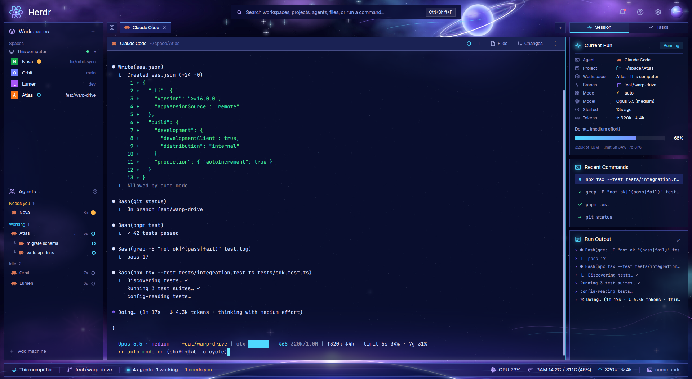

# Quantum: a space layout for Herdr

A deep-space layout for the [Herdr](https://herdr.dev) app: glass panels floating over a nebula, a
command search title bar, a live **Session** panel (current run, recent commands, run output),
and a status bar with CPU, RAM and tokens.



## Install

Ask your agent in Herdr to add it:

> add the layout github.com/PsyChaos/herdr-quantum

Or copy it by hand:

```sh
git clone https://github.com/PsyChaos/herdr-quantum
cp -r herdr-quantum/mods/quantum ~/.config/herdr-app/mods/
cp herdr-quantum/layouts/quantum.json ~/.config/herdr-app/layouts/
cp herdr-quantum/themes/quantum.json ~/.config/herdr-app/themes/
herdr-app do layout.switch '{"name":"quantum"}'
```

`ctrl-shift-l` switches back to your own layout.

## Tasks tab (optional)

The right column gets a **Tasks** tab when the [task-board](https://github.com/PsyChaos/herdr-mods/tree/main/task-board)
mod is installed: it lists the tasks your agents hand out to sub-agents (`hc run`), grouped under
the agent that started them. Without it Quantum shows only the Session panel.

Ask your agent in Herdr to add it:

> add the mod github.com/PsyChaos/herdr-mods/tree/main/task-board

Or copy it by hand:

```sh
git clone https://github.com/PsyChaos/herdr-mods
cp -r herdr-mods/task-board ~/.config/herdr-app/mods/
```

Quantum finds it within 30 seconds and adds the tab. It then writes `task-board` into
`layouts/quantum.json`; if you remove task-board later, put that layout back from this repo too,
or Herdr won't open it.

## What it reads

- **Agent screens:** it runs `hc read` (the visible screen only) on the agent it shows, to find the model, effort, context
  and token counts in Claude Code's status line, plus its recent shell commands and output.
- **System files:** it reads `/proc/stat` and `/proc/meminfo` for the CPU and RAM meters.
- **Layout:** when task-board is installed it runs `herdr-app do layout.set` to point the Tasks
  block at it (once; again only if the block is put back).
- **Network:** it makes no network requests.

To get the model, context and token details, use a Claude Code status line like
the one in [`extras/claude-statusline.sh`](extras/claude-statusline.sh):

```sh
cp extras/claude-statusline.sh ~/.claude/statusline.sh
jq '.statusLine={"type":"command","command":"~/.claude/statusline.sh","padding":0}' ~/.claude/settings.json > /tmp/s && mv /tmp/s ~/.claude/settings.json
```
