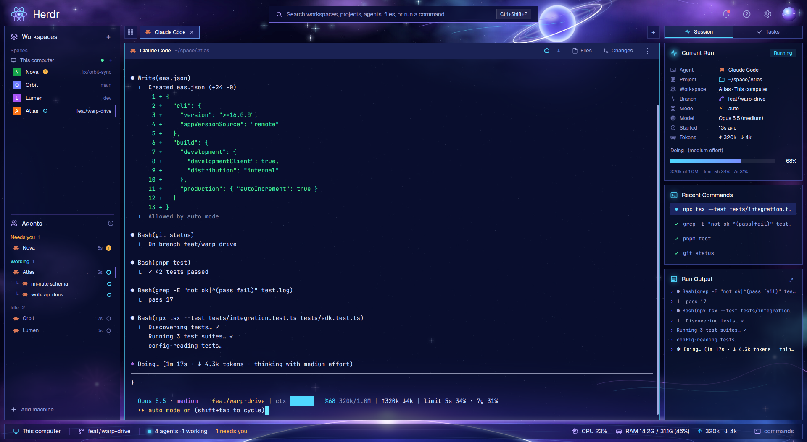

# Quantum

A deep-space layout for Herdr. The window sits on near-black deep navy, with nebula colour only
where the panels leave it showing: around a glassy ringed planet at the top, the window's edges
and lower corners, and the glowing rim of a giant planet behind the status bar. Every region is a dark glass
card whose edges catch the light: a thin rim that runs bright cyan from the top-left corner and
fades to violet along each edge, spilling a little light around its brightest parts. From top to
bottom: a title bar with a command search; then the workspaces and agents, the terminals and a
live Session panel side by side; then a status bar.

## What you see

- **Background:** `mods/quantum/nebula-deep.jpg` (2560×1440, `cover`), made by `art/nebula.py`.
  It has:
  - a base of `#03041a` to `#080a2e`;
  - nebulae from four fractal-noise layers in violet `#7b3cff`, blue `#2f5bff`, magenta
    `#d23cff` and cyan `#2fd0ff`, masked to the title band, the side edges and the lower corners;
  - about 1700 stars, 30 of them with four-point glints, and two starbursts (pink in the
    sidebar's lower corner, blue in the right column's);
  - a glassy ringed planet over the title bar: a bright rim, four rings tilted −22°;
  - a giant planet rising behind the status bar: white rim, blue bloom, pink flare, orbit lines;
  - neon swirls near the planet and in the lower right.
- **Neon frames:** the look shared by every card.
  - **Line:** each lit card has a crisp 1.2px line whose colour runs along the diagonal: cyan
    `#b8f6ff` at the top-left, `#8d96ff`, violet `#7a5cff`, pink-violet `#e08bff` at the
    bottom-right. A white highlight runs along the top edge.
  - **Brightness:** brightest along the top, dimmest halfway down the sides, brighter again
    at the bottom.
  - **Light:** a wide blurred copy in `#5a4cff` and a near one spill the light around the card.
  - **Glass:** panels are nearly opaque navy `#0d1338ea`; the session cards `#0b1432c8`.
  - **Sidebar and status bar rims:** a white-blue top `#dfe2ff`, dim blue `#3c4498` sides,
    violet `#7c5cd0` toward the bottom, with a `#3434c8` glow.
  - **Selected items** (the active space, focused and working agents, the active tab, the
    Session switch): a dark navy fill `#131a4a` with a blue light just inside its edges and a
    thin bright outline (near-white lilac to blue to violet; cyan-led for the tab and the
    switch), with a faint glow outside. The picture carries the fill and sits behind the
    item's content.
  - **Terminal card:** a thin blue rim, brightest along the top; fill `#0b1131`.
- **Title bar (56px, draggable):**
  - The atom logo (42px) over a violet halo, and "Herdr" at 25px bold.
  - A 38px pill search field with an edge light and the palette key on a keycap.
  - A bell (a pink dot; red when an agent needs you, and a click focuses it), help, settings
    and a planet orb on the right. Window buttons appear where the system draws
    none.
- **Workspaces and agents (276px):**
  - **Header:** "Workspaces" with a + button.
  - **Spaces:** grouped under "This computer" and each machine. The machine row has a green,
    amber or gray dot for its state and a + button.
  - **Space rows:** a colored letter tile (from the name), the name, the space's status, and its
    repo and branch in dim text. The active row is a violet glass pill with an edge light.
  - **Agents:** grouped as Pinned, Needs you (amber), Working (cyan), Done and Idle, each group
    with its count.
  - **Agent rows:** the program icon, space and tab, machine, time since the last change, and a
    status mark. The mark is an amber ring for working, an amber "!" for blocked, a green dot
    for done and a dim ring for idle. Nothing spins.
  - **Sub-agents:** nested under their parent with "└". Clicking the parent's icon folds them.
  - **Footer:** Settings and Add machine.
- **Work area:**
  - **Tab bar (53px):** a 40px tab row over the top of the work area's shell. The grid button
    (picker) is the shell's own folder tab: its left side is the shell's left side. The tabs are
    32px boxes with rounded tops standing on the shell's top edge: inactive ones dark `#171b45`
    with a thin `#262b62` border, the active one dark too, radius 9, with a thin outline
    running pink-violet at the top-left to cyan on the right and a faint glow. No + button (the
    pane header's + and the new-tab keys make tabs).
  - **Shell:** a faint rounded frame (radius 18, square at the top-left where the grid tab
    grows out of it) round the tab row's base and the terminal card: fill `#0a153c`, a 1.2px
    dim blue line, a little brighter along the top.
  - **Card:** inside the shell, 8px below its top and 6px in from its sides and bottom: one
    rounded rim (radius 14) round all the panes, unbroken at the corners, a 1.5px blue line
    (cyan toward the right), brightest along the top, with a gentle blue glow. The panes sit
    5px inside it.
  - **Panes:** transparent, with no border or radius of their own.
  - **Pane header (38px, `role: "pane"`):** a `#1a2254` band with a `#454c86` line under it.
    The card picture paints the same band and line out to the rim, so the header runs full
    width:** the program icon and name, the folder in dim text,
    the status, then `+` (split right), Files, Changes and `⋮` (the pane menu). Files and
    Changes appear only here.
  - **Terminals:** `terminal_opacity` 0, over the card's own fill.
- **Right column (330px):**
  - **Header (`role: "sidetabs"`, 62px):** a segmented control in a dark `#141e42` box
    (radius 12), Session, Tasks and Files; the active segment is lit like a selected item,
    cyan at the left. It switches
    the `side-body` stack between this mod's session panel, Herdr's `task-board` and `files`.
  - **Cards:** Current Run, Recent Commands and Run Output (it fills the rest of the column),
    each separate translucent glass (`#0b1432c8`, radius 12) with a thin blue rim, brighter at
    the top-left and along the bottom, almost no outer light and a soft light inside the top and
    bottom edges. They are 12px apart and 4px in from the column. There is no frame round the
    column. Rows are 16px tall at 12.3px, 7px apart; a rule under the Current Run title.
  - **Status pill:** a 20px outline in the status colour over a faint tint of it: cyan Running,
    amber Needs you, green Done, dim Idle.
- **Status bar (44px):** machine, branch, agent count with a glowing dot, CPU, RAM, ↑↓ tokens,
  and "commands".
- **Theme:** `themes/quantum.json`: terminal `#0a0b26`, foreground `#dfe4ff`, cyan cursor and
  neon ANSI colors. The layout's `colors` make `canvas` transparent and the panels translucent.
- **Type:** Geist for the UI; JetBrains Mono for commands and output.

## How it behaves

- **The run it follows:** the focused agent. With none focused, the most recent agent of the
  shown tab, then of the shown space. With none at all, it says "Focus an agent's pane to see its
  run."
- **Current Run:**
  - A status pill with its own edge light: Running in cyan (breathing), Needs you in amber, Done
    in green, Idle in dim.
  - Rows for agent, project, workspace and machine, branch, mode (auto, accept edits, plan,
    bypass or default), model (effort), started, and tokens.
  - A 30-segment context bar shading from cyan to violet. It breathes while the agent works and
    shows the percent left and the 5-hour and 7-day limits.
- **Recent Commands:** the last six `● Bash(...)` calls, newest first. The newest has a cyan dot
  and a lighter row while the agent works.
- **Run Output:** the last seven conversation lines above the agent's prompt box.
- **Clicks and keys:**
  - A space row selects the space; its + makes a new one on that machine.
  - An agent row focuses its pane.
  - A tab selects; double-click renames; right-click opens the tab menu.
  - Scrolling over the tab bar steps through the tabs.
  - Files and Changes in the pane header toggle the side panel; Session, Tasks and Files switch the
    right column.
  - Search and "commands" open the palette.
- **Refresh:** the session panel every 4s, the status bar every 5s, and the sidebar's
  "4m" labels every 30s. There are no animations (no `.frames`, `.loop` or `.spin`), so the
  window only redraws when something changes.

## Built from

- **Layout:** `layouts/quantum.json`.
  - Root `column`:
    - `top`: block, `quantum` with `role: "top"`.
    - `body`: row of `sidebar` (block, `role: "sidebar"`), `work` and `session` (a column of
      `side-tabs` and the `side-body` stack).
    - `status`: block, `role: "status"`.
  - `session` is a column of `side-tabs` (62px) and the `side-body` stack (`side-session`,
    `side-tasks`, `side-files`).
  - `work` is a column of `tabs` (53px, `role: "tabs"`) and `card`.
    - `card` is a row of `edge-left` (14px), `work-body` and `edge-right` (14px), over
      `edge-bottom` (14px). The edges are `role: "edge"` blocks.
    - `work-body` contains the active tab, and the `panel` stack of `files` and `changes`.
  - Root settings: `titlebar: "none"`, `theme: "quantum"` plus `colors` overrides,
    `terminal_opacity: 0`, and the background image.
- **Mod:** `mods/quantum`.
  - `main.js` holds the seven roles: top, sidebar, tabs, pane, sidetabs, session, status. `ui.js` holds the palette, `neon` (a framed element), `panel`, `bar`, `halo`, letter tiles, status marks and `ago`.
- **Shipped mods used:** `files`, `changes`, `task-board`; `new-menu`, `menu`, `picker`
  and `machine-add` as overlays. Some icons come from `mods/workspace-chrome`, `mods/pane`,
  `mods/files` and `mods/changes`.
- **`herdr` API used:**
  - Data: `spaces()`, `agents()`, `terminals()` (for `parent`), `machines()`, `panes()`,
    `focused()`, `layout()`, `shared("workspace.panels")`, `keys()`, `window()`, `home()`.
  - Overlays: `openOverlay`.
  - Commands, through `run`: `space.select`, `space.new`, `pane.focus`, `tab.select`, `tab.close`,
    `tab.rename`, `tab.prev`, `tab.next`, `layout.select`, `layout.show`, `layout.hide`,
    `layout.toggle`, `app.palette`, `app.help`, `app.settings`, `mod.open`, and the
    `window.minimize`, `window.maximize` and `window.close` buttons.
- **Programs and files read:**
  - `hc read <agent> --lines 400` (session) or `--lines 0` (status), for the agent's screen.
  - `/proc/stat` and `/proc/meminfo`, read with `readTextFile`, for CPU and RAM.
- **What the screen is parsed for:**
  - The status line: `Model · effort | branch | ctx <bar> %NN used/size | ↑in ↓out | limit 5s A% · 7g B%`.
    `extras/claude-statusline.sh` prints it for Claude Code.
  - The progress line: `✻ Verb… (time · ↓ tokens · …)`.
- **Art:** `art/nebula.py` (SVG rasterized with `rsvg-convert`); `halo-*.png` (radial gradients);
  `logo.svg`, `orb.svg` and line icons.
- **Preview:** `art/demo-agent.sh` is a fake agent used to stage `preview.png`. It ran in a
  separate `HC_SESSION`, with made-up spaces.

## Watch out

- **Light without CSS:** elements take solid colors only (no gradients, blur or colored
  shadows), and `image()` never stretches. So the neon is a picture of exactly the element's
  size:
  - `on_size_change` measures each lit element;
  - `ui.js` writes an SVG of that size (a gradient stroke plus two `feGaussianBlur` copies) to
    `mods/quantum/.glow/`, named by tone, radius, spread and size;
  - the SVG is shown as an `absolute` image over the element (behind it for selected items,
    whose picture carries the fill).
  The folder is hidden, so writing to it doesn't reload the mod. Drawing the light from solid
  segments or stacked borders looked broken (gaps at corners, banding).
- **Images don't stretch:** `image()` keeps its aspect ratio, so glows from pictures only work
  for round spots (`halo`).
- **Padding:** it is a number or `[vertical, horizontal]`. Theme files take `#rrggbb` only;
  translucency goes in the layout's `colors` as `#rrggbbaa`.
- **Image cache:** the app caches images by path. Rename a picture (as `space.jpg` became
  `nebula-deep.jpg`) to see a new version at once.
- **The card's neon is drawn in pieces.** Only the root node draws a background picture,
  so a node's `background.image` can't carry the card's frame. So:
  - one SVG (`ui.js cardSvg`, sizes in `CARD`) holds the whole work area: the shell, the
    card's opaque fill `#0b1131`, the header band, the card's crisp line and its light;
  - it is shown in slices: the tab bar shows its top 16px, three 14px `edge` blocks
    (`role: "edge"`, `side: left | right | bottom`) its sides and bottom;
  - the tab bar measures the width and the left edge the card's middle height; they share
    them (`quantum.midH`, `quantum.card`).
- **Square corners:** a terminal paints its background over its whole pane, square, whatever
  the pane radius. So:
  - `terminal_opacity` is 0 and pane backgrounds are transparent;
  - between the slices, the `work-body` node paints a square fill of exactly the same
    opaque colour, with no border and no radius, so there is no seam;
  - the rim, its corners and the fill near the edge are all in the slices. The slices are
    5px deep inside the rim, more than the 0.3 × radius a corner arc needs, so each corner
    lies wholly in one picture. A node border plus separate glow strips left gaps and doubled
    lines at the corners.
- **Frames sit on the edge:** each framed element's picture is made for its measured size (to
  a quarter pixel), with the same corner radius and the line centred on the element's edge.
  The element draws no border of its own. The top highlight fades out before the corners,
  and the wide light is masked to the outside, so the corners stay clean.
- **Meters:** CPU needs two samples (it appears on the second refresh). CPU and RAM are Linux
  only and measure the machine the window runs on.
- **Parsing:** it expects Claude Code's look (`●` tool calls, `─────` lines around the prompt).
  Other agents still get status, folder, branch and timing.

## Done when

- `herdr-app check mods/quantum` passes, and `layout.switch {"name":"quantum"}` shows the nebula
  and planets behind edge-lit glass cards, with no layout error.
- Focusing a Claude Code pane fills Current Run within 3s: model, effort, tokens, and the context
  bar with its percent.
- A working agent shows an amber ring and a lit row in the sidebar, a cyan dot in Recent
  Commands and the cyan Running pill.
- Clicking a space row switches spaces. The search field opens the palette. Files in a pane
  header opens the Files panel beside the panes, and a second click closes it. Tasks shows the
  task board in the right column.
- CPU and RAM appear in the status bar on Linux within 6s.
